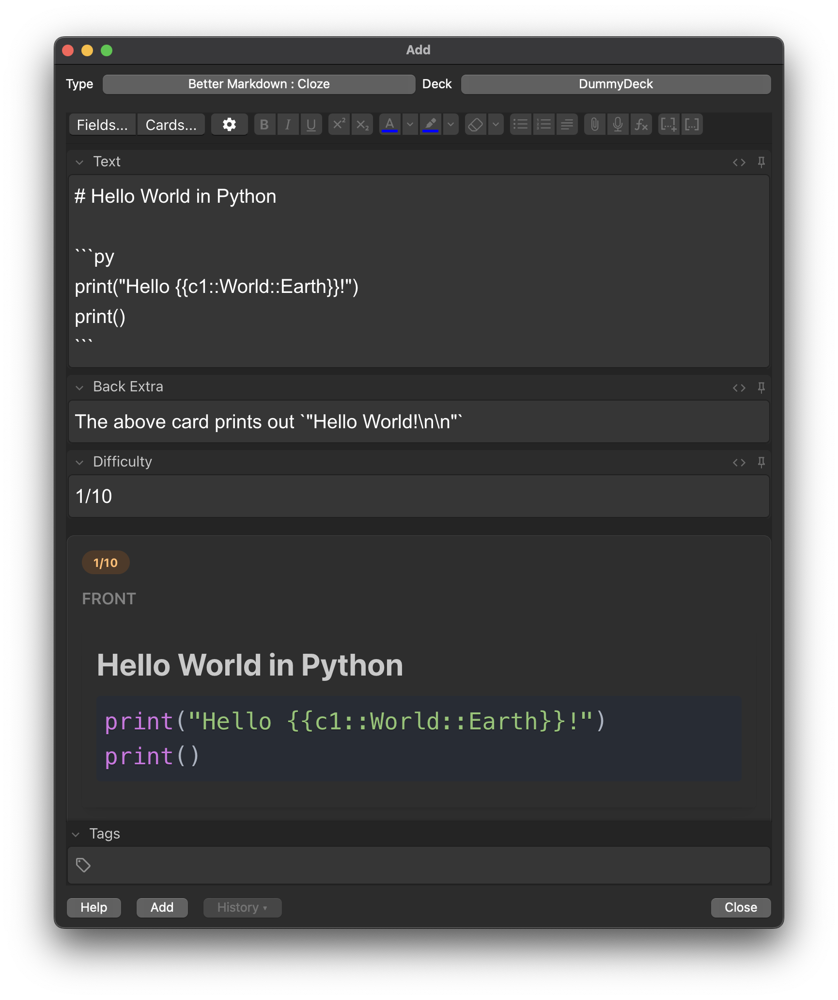

# Better Markdown Anki

A powerful React-based Anki add-on that transforms your flashcards with advanced markdown rendering, interactive features, and modern web technologies for an enhanced study experience.

## Preview




## Features

### 🎨 Enhanced Visual Experience
- **Theme-aware design** that automatically adapts to Anki's light/dark mode
- **Color-coded card sections** with distinct styling for front, back, and extra content
- **Modern UI components** built with React and Mantine UI library

### 📝 Advanced Markdown Support
- **Full markdown rendering** with proper formatting for headers, lists, tables, and more
- **LaTeX math support** using KaTeX for both inline (`$...$`) and block (`$$...$$`) equations
- **Syntax highlighting** for code blocks with language-specific coloring
- **HTML entity decoding** for proper character display

### 🔄 Interactive Cloze Deletions
- **Toggle switches** for each cloze deletion to show/hide content dynamically
- **Smart cloze processing** that preserves formatting within code blocks and math expressions
- **Visual indicators** for active/inactive cloze states

### 🏷️ Smart Card Organization
- **Tag display** with styled badges for easy categorization
- **Difficulty indicators** to show card complexity at a glance

## Installation

1. Download the add-on from the Anki add-on repository or by downloading the `.ankiaddon`.
2. In Anki, go to **Tools** → **Add-ons** → **Install from file...**
3. Select the downloaded file and restart Anki
4. The add-on will automatically create the necessary note types on first launch

## Built-in MCP server

Better Markdown includes an optional, local MCP server for compatible assistants.
It exposes public card-writing guidance plus tools to list decks, search and read
Better Markdown notes, create or update notes, and store a local HTML walkthrough.
The MCP server requires Anki desktop with an open profile; it does not work when
Anki is closed. It is disabled by default and does not sync your collection.

### Connect Codex

1. Open an Anki profile and select **Tools → Connect Better Markdown to Codex**.
2. Restart Codex and open a new chat. The action enables the server and saves
   the connection in Codex's config.

Alternatively, select **Tools → Enable Better Markdown MCP** in Anki and run:

```sh
codex mcp add better-markdown-anki --url http://127.0.0.1:19176/mcp
```

### Connect other MCP clients

Select **Tools → Enable Better Markdown MCP** in Anki. Connect a Streamable HTTP
client to `http://127.0.0.1:19176/mcp` (or the configured port).

For **GitHub Copilot CLI**, run:

```sh
copilot mcp add --transport http better-markdown-anki http://127.0.0.1:19176/mcp
```

For **Google Antigravity**, open the agent panel menu → MCP Servers → Manage MCP
Servers → View raw config, and merge this entry into `mcp_config.json`:

```json
{"mcpServers":{"better-markdown-anki":{"serverUrl":"http://127.0.0.1:19176/mcp"}}}
```

Other compatible agents can use the same URL. Anki must be open on the same
machine as the client; `127.0.0.1` on a remote machine refers to that machine.
See the [Copilot MCP reference](https://docs.github.com/en/copilot/how-tos/copilot-cli/customize-copilot/add-mcp-servers)
and [Antigravity MCP guide](https://antigravity.google/docs/mcp) for details.

The server binds only to `127.0.0.1` and rejects nonlocal Host and Origin
headers. While enabled, local programs can read and change your open collection
without authentication. Do not expose the port publicly. Disable `mcp_enabled`
and restart Anki to turn the server off.

### Using the tools

Call `card_authoring_guide` for general writing, formatting, and step-by-step HTML walkthrough instructions. Call `validate_note` to check a complete card before saving it. The create and update tools reject detected errors and return warnings; validation is best-effort and does not replace an Anki preview.
`create_note` accepts `note_type` (`basic` or `cloze`), an existing `deck`, and
plain Markdown `fields`. For example, a Basic note can use:

```json
{"deck":"Default","note_type":"basic","fields":{"Front":"Why use a write-ahead log?","Back":"**It records changes before data pages are written, enabling recovery.**","Extra":"A database can replay committed changes after a crash."},"tags":["Databases"]}
```

Cloze fields are `Text`, `Back Extra`, and `Difficulty`; Basic fields are
`Front`, `Back`, `Extra`, and `Difficulty`. The server escapes Markdown for
Anki's HTML storage. `get_note` reports stored field values in Anki HTML;
`update_note` accepts plain Markdown and replaces only the fields supplied.
Keep a backup before bulk edits. MCP changes are local until your usual Anki
sync runs. The experimental HTML walkthrough tool stores a file in media;
verify playback, export, and sync on your target clients.

## Note Types

The add-on creates two specialized note types:

### Better Markdown : Basic
- **Fields**: Front, Back, Extra, Difficulty
- **Use case**: Traditional question-answer flashcards with markdown formatting

### Better Markdown : Cloze
- **Fields**: Text, Back Extra, Difficulty  
- **Use case**: Interactive cloze deletion cards with enhanced markdown support

## Usage

1. Create a new note using one of the "Better Markdown" note types
2. Write your content using standard markdown syntax
3. The add-on will automatically render your markdown with enhanced styling
4. Math expressions can be written using LaTeX syntax
5. Use toggle switches to interact with cloze deletions dynamically

### Copy a card for an LLM chat

Select **Copy for LLM chat** beside the tags and difficulty to copy the available front, back, and extra fields in a labeled prompt. Local HTML walkthroughs referenced with image syntax are included as HTML source. If a file cannot be read, its filename is included in the prompt and the button reports it. On the question side, only currently available fields are copied. On cloze review cards, Anki supplies the revealed text on the answer side; a separate front field may not be available.

### Fenced-code protection

On Anki desktop, the add-on protects fenced code when the editor loads and before the reviewer displays it, keeping comparisons and HTML tags from being interpreted as markup. This does not repair a field that was already saved in a corrupted form, and external tools that save raw HTML can still damage a field before the add-on sees it. Anki's editor line-break and cloze markup is preserved where recognizable.

### Interactive HTML walkthroughs (experimental)

Copy a self-contained HTML file into the active profile's `collection.media` folder and reference it in a note with image syntax:

```markdown

```

The renderer displays local `.html` or `.htm` filenames in a 500-pixel-high sandboxed frame with scripts enabled. Use trusted, self-contained files: the sandbox restricts same-origin access, and links, forms, storage, and separately loaded resources may not work. Ordinary images continue to render as images. The filename must be a single media filename, not a path or URL.

This feature has not yet been verified on Anki desktop or mobile. Anki's media checker may not recognize Markdown references; a leading underscore protects the file from the unused-media check, but verify that the file reaches each device and is included in exports before relying on it. See the [Anki media manual](https://docs.ankiweb.net/media.html).

## Technical Architecture

### Core Technologies
- **React 19** with modern hooks and functional components
- **Mantine UI** for consistent, accessible component design
- **Vite** for fast development and optimized builds
- **TypeScript** support for type safety

### Markdown Processing Pipeline
- **`ReactMarkdown`** for base markdown parsing
- **`remark-math`** + **`rehype-katex`** for mathematical expressions
- **`react-syntax-highlighter`** for code block formatting

### Key Features
- **DOM mutation observation** for real-time card updates
- **Automatic theme detection** from Anki's CSS classes
- **Python backend integration** with Anki's API
- **Automatic template and field management** with version control

## Development

```bash
# Install frontend dependencies
cd frontend
npm install

# Start development server
npm run fixtures
npm run dev

# Open http://localhost:5173/deck-preview.html to inspect the example cards

# Run the automated regression suite and lint checks
npm test
npm run lint

# Build the production assets into better-markdown-anki/dist
npm run build

# Run the add-on integration tests from the repository root
cd ..
python3 -m unittest discover -s tests -v
```

## Configuration

The add-on includes automatic configuration management:
- Templates are updated automatically when the add-on loads
- Missing fields are added to existing note types
- Theme mode detection from Anki's CSS classes
- Content changes monitored through DOM mutation observation

## Browser Compatibility

Optimized for modern browsers with support for ES2020+ features, CSS custom properties, and DOM MutationObserver API.
